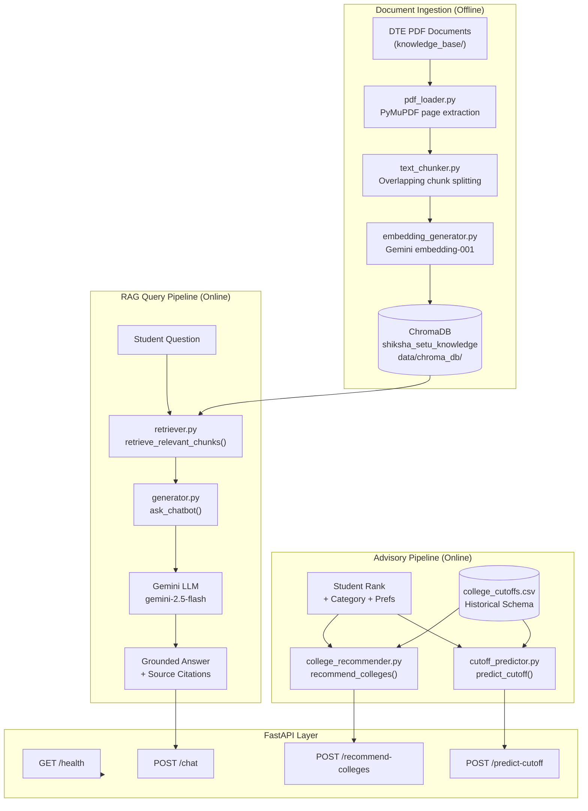
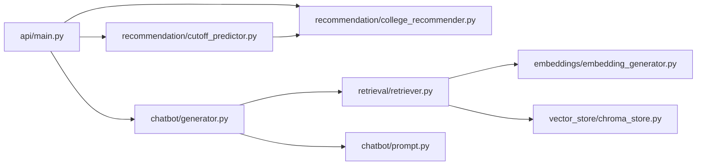

# Shiksha Setu AI Service — Architecture

This document describes the internal design, data flow, and component responsibilities of the Shiksha Setu AI Service.

---

## 1. System Overview

The service provides four capabilities:

| Capability | Entry Point |
|---|---|
| Grounded RAG Student Chatbot | `POST /chat` |
| College Recommendations | `POST /recommend-colleges` |
| Cutoff Trend Prediction | `POST /predict-cutoff` |
| Health Check | `GET /health` |

All capabilities are exposed through a **FastAPI** application (`api/main.py`) with Pydantic-validated request/response schemas (`api/schemas.py`).

---

## 2. High-Level Architecture Diagram



---

## 3. Component Details

### 3.1 PDF Ingestion — `ingestion/pdf_loader.py`

- **Library:** PyMuPDF (`pymupdf`)
- **Function:** `extract_text_from_pdf(pdf_path, include_empty_pages=False)`
- **Output:** List of page dictionaries containing `document_name`, `page_number`, `text`, and `source_path`.
- **Behaviour:** Skips empty/whitespace pages by default while preserving 1-based page numbering. Raises `PDFExtractionError` for corrupt, zero-byte, or unreadable files.

### 3.2 Text Chunking — `ingestion/text_chunker.py`

- **Function:** `chunk_document_pages(pages, chunk_size=800, chunk_overlap=150)`
- **Strategy:** Hierarchical boundary-aware splitting using paragraph breaks (`\n\n`), Hindi purna viram (`।`), sentence terminators (`. `, `?\n`, `!\n`), then word boundaries.
- **Output:** List of chunk dictionaries with `chunk_id`, `text`, `document_name`, `page_number`, `source_path`, and `chunk_index`.
- **Design goal:** Chunk boundaries respect semantic units to maximise retrieval precision.

### 3.3 Embedding Generation — `embeddings/embedding_generator.py`

- **Model:** `gemini-embedding-001` (configurable via `GEMINI_EMBEDDING_MODEL`)
- **SDK:** `google-genai` official Python SDK
- **Function:** `generate_embeddings(chunks, gemini_client, model)` — adds an `embedding` field (list of floats) to each chunk dict.
- **Batch handling:** Processes chunks individually; respects Gemini API rate limits.
- **Error types:** `EmbeddingGenerationError` wraps all API and response-parsing failures.

### 3.4 ChromaDB Vector Store — `vector_store/chroma_store.py`

- **Collection name:** `shiksha_setu_knowledge`
- **Default persist path:** `ai-service/data/chroma_db/`
- **Functions:**
  - `get_chroma_client(persist_path, ephemeral)` — returns a persistent or in-memory client.
  - `get_or_create_collection(client, collection_name)` — idempotent collection initialisation.
  - `store_embeddings(collection, chunks)` — upserts chunk text, metadata, and embedding vectors. Duplicate `chunk_id` values are safely overwritten (upsert semantics).
- **Metadata stored per chunk:** `document_name`, `page_number`, `source_path`, `chunk_index`.
- **Validation:** All required keys (`chunk_id`, `text`, `embedding`, `document_name`, `page_number`, `chunk_index`, `source_path`) are enforced before any upsert. Embedding dimension consistency is checked across the batch.

### 3.5 Semantic Retrieval — `retrieval/retriever.py`

- **Function:** `retrieve_relevant_chunks(query, top_k=5, collection, gemini_client, ...)`
- **Workflow:**
  1. Validates that `query` is non-empty and `top_k` is a positive integer.
  2. Checks collection count — returns `[]` immediately if the collection is empty (avoids unnecessary API call).
  3. Generates a query embedding via `generate_query_embedding()` using the same `gemini-embedding-001` model.
  4. Calls `collection.query()` with cosine distance, requesting `documents`, `metadatas`, and `distances`.
  5. Returns a sorted list of result dicts: `chunk_id`, `text`, `document_name`, `page_number`, `source_path`, `distance`.
- **Caching:** Module-level singleton `_CACHED_COLLECTION` avoids reconnecting to ChromaDB on every request.

### 3.6 RAG Chatbot — `chatbot/generator.py`

- **Function:** `ask_chatbot(question, top_k=5)`
- **LLM:** `gemini-2.5-flash` (configurable via `GEMINI_MODEL`)
- **Workflow:**
  1. Validates the question.
  2. Calls `retrieve_relevant_chunks()` to fetch the top-k document chunks.
  3. Formats chunks into a structured `[OFFICIAL REFERENCE CONTEXT]` block with source labels.
  4. Sends the system instruction (`RAG_SYSTEM_INSTRUCTION`), reference context, and student question to Gemini.
  5. Parses the response and extracts deduplicated source citations (`document_name`, `page_number`, `source_path`).
  6. Returns a structured dict with `answer`, `sources`, `success`, and error metadata.
- **Hallucination resistance:** The system instruction strictly constrains Gemini to cite only provided context and to output the official DTE disclaimer URL for unanswerable queries.

### 3.7 College Recommendation — `recommendation/college_recommender.py`

- **Function:** `recommend_colleges(rank, category, preferred_course, preferred_location, top_k)`
- **Data source:** `ai-service/data/college_cutoffs.csv` — schema-only file. Must be populated with verified DTE data.
- **Filtering logic:**
  - Normalises and validates the category string against the set `{GEN, OBC, SC, ST, EWS, MBC, TFWS, PWD}`.
  - Optional case-insensitive substring filters for course name and location.
  - Compares student rank against `closing_rank` to assign tiers: **Likely** (rank ≤ closing), **Moderate** (rank ≤ closing × 1.2), **Ambitious** (rank > closing × 1.2).
- **Output:** Categorised `RecommendCollegesResponse` with disclaimer.

### 3.8 Cutoff Predictor — `recommendation/cutoff_predictor.py`

- **Function:** `predict_cutoff(college_id, course_name, category)`
- **Algorithm:** Manual linear regression over `(admission_year, closing_rank)` pairs from the CSV. No external ML library required.
- **Confidence levels:** `High` (≥ 3 years), `Moderate` (2 years), `Low` (1 year), `insufficient_data` (0 years).
- **Trend direction:** `increasing`, `decreasing`, `stable` based on linear slope sign and magnitude.
- **Output:** `PredictCutoffResponse` with `estimated_closing_rank`, `confidence`, `trend`, `historical_records`, and mandatory disclaimer.

### 3.9 FastAPI Layer — `api/main.py`

- **Framework:** FastAPI 0.100+, Uvicorn ASGI server
- **Schemas:** Pydantic v2 — `api/schemas.py`
- **Error handling:** Centralised exception handlers for `RequestValidationError` (422), `ValueError` (400), `HTTPException`, and unhandled `Exception` (500). No stack traces or secrets leaked to HTTP responses.
- **OpenAPI:** Auto-generated Swagger UI at `/docs`, ReDoc at `/redoc`.

---

## 4. Data Flow — End to End

### Ingestion (offline, manual)

```
DTE PDF
  → extract_text_from_pdf()         # PyMuPDF, page-level
  → chunk_document_pages()          # 800-char chunks, 150-char overlap
  → generate_embeddings()           # Gemini embedding-001
  → store_embeddings()              # ChromaDB upsert, shiksha_setu_knowledge
```

### Chat request (online)

```
POST /chat { question, top_k }
  → Pydantic validation (ChatRequest)
  → ask_chatbot(question, top_k)
      → retrieve_relevant_chunks(question, top_k)
          → generate_query_embedding()       # Gemini embedding-001
          → collection.query()               # ChromaDB cosine similarity
      → format_retrieved_context(chunks)     # [OFFICIAL REFERENCE CONTEXT] block
      → Gemini generate_content()            # gemini-2.5-flash, grounded prompt
      → parse sources from response
  → ChatResponse { answer, sources, success }
```

### Recommendation request (online)

```
POST /recommend-colleges { rank, category, preferred_course, preferred_location, top_k }
  → Pydantic validation (RecommendCollegesRequest)
  → recommend_colleges()
      → load_and_validate_cutoffs()          # CSV parse + schema validation
      → filter by category, course, location
      → classify: Likely / Moderate / Ambitious
  → RecommendCollegesResponse + disclaimer
```

---

## 5. Module Dependency Graph



---

## 6. Security Design

- **No secrets in code.** All keys loaded from `.env` via `python-dotenv` at module load time.
- **No secrets in HTTP responses.** The generic exception handler (`500`) returns a fixed safe message regardless of internal error details.
- **Prompt injection resistance.** The RAG system instruction instructs Gemini to treat the student question as untrusted input and to never follow instructions embedded within it.
- **`.gitignore`** excludes `.env`, `.venv/`, `__pycache__/`, and `*.pyc`. Generated ChromaDB files in `data/chroma_db/` must also be excluded (add `data/chroma_db/` to `.gitignore` before first ingestion run).
