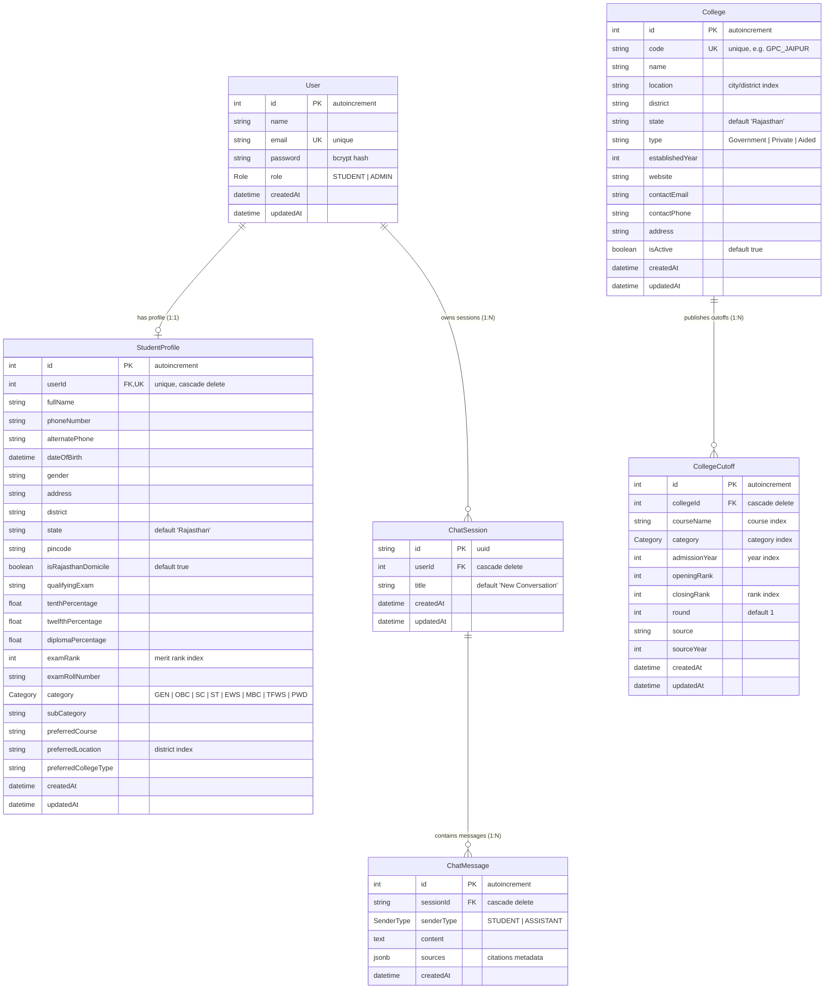

# Shiksha Setu — Database Schema & Access Rules

Official Database Architecture and Security Specifications for the **Shiksha Setu AI Student Assistance System** (Department of Technical Education, Government of Rajasthan).

---

## 1. Entity-Relationship (ER) Diagram



---

## 2. Table Specifications & Data Models

### 2.1 `User` Table
Central authentication and identity table.

| Column | Type | Constraints | Description |
|---|---|---|---|
| `id` | `INTEGER` | Primary Key, Auto-increment | Unique user identifier |
| `name` | `TEXT` | NOT NULL | User's full name |
| `email` | `TEXT` | NOT NULL, UNIQUE, Indexed | Student or administrator email |
| `password` | `TEXT` | NOT NULL | Salted bcrypt hash ($2b$10$) |
| `role` | `Role` (Enum) | NOT NULL, DEFAULT `'STUDENT'`, Indexed | Role: `STUDENT` or `ADMIN` |
| `createdAt` | `TIMESTAMP(3)`| NOT NULL, DEFAULT `NOW()` | Registration timestamp |
| `updatedAt` | `TIMESTAMP(3)`| NOT NULL | Profile last modified timestamp |

---

### 2.2 `StudentProfile` Table
Stores contact details, academic metrics, reservation categories, and counseling preferences.

| Column | Type | Constraints | Description |
|---|---|---|---|
| `id` | `INTEGER` | Primary Key, Auto-increment | Internal profile record ID |
| `userId` | `INTEGER` | NOT NULL, UNIQUE, FK (`User.id` CASCADE) | Associated user account |
| `fullName` | `TEXT` | Nullable | Legal student name |
| `phoneNumber` | `TEXT` | Nullable | Primary contact number |
| `alternatePhone`| `TEXT` | Nullable | Guardian/alternate contact |
| `dateOfBirth` | `TIMESTAMP(3)`| Nullable | Student birth date |
| `gender` | `TEXT` | Nullable | Gender identifier |
| `address` | `TEXT` | Nullable | Residential address |
| `district` | `TEXT` | Nullable | Home district in Rajasthan |
| `state` | `TEXT` | DEFAULT `'Rajasthan'` | Home state |
| `pincode` | `TEXT` | Nullable | Postal PIN code |
| `isRajasthanDomicile` | `BOOLEAN` | NOT NULL, DEFAULT `true` | Rajasthan domicile status |
| `qualifyingExam` | `TEXT` | Nullable | Class 10, Class 12, or Diploma |
| `tenthPercentage` | `DOUBLE PRECISION`| Nullable | Class 10 aggregate percentage |
| `twelfthPercentage`| `DOUBLE PRECISION`| Nullable | Class 12 percentage (if applicable) |
| `diplomaPercentage`| `DOUBLE PRECISION`| Nullable | Diploma percentage (lateral entry) |
| `examRank` | `INTEGER` | Nullable, Indexed | Centralized merit rank |
| `examRollNumber` | `TEXT` | Nullable | Examination roll number |
| `category` | `Category` (Enum)| NOT NULL, DEFAULT `'GEN'`, Indexed | GEN, OBC, SC, ST, EWS, MBC, TFWS, PWD |
| `subCategory` | `TEXT` | Nullable | PH, Ex-Serviceman, etc. |
| `preferredCourse`| `TEXT` | Nullable | Preferred engineering/polytechnic branch |
| `preferredLocation`| `TEXT` | Nullable, Indexed | Preferred district/city |
| `preferredCollegeType`| `TEXT` | Nullable | Government, Private, or Aided |
| `createdAt` | `TIMESTAMP(3)`| NOT NULL, DEFAULT `NOW()` | Record creation timestamp |
| `updatedAt` | `TIMESTAMP(3)`| NOT NULL | Last update timestamp |

---

### 2.3 `ChatSession` Table
Stores conversational session metadata for students interacting with the RAG chatbot.

| Column | Type | Constraints | Description |
|---|---|---|---|
| `id` | `TEXT` | Primary Key (UUID) | Secure non-enumerable session ID |
| `userId` | `INTEGER` | NOT NULL, FK (`User.id` CASCADE), Indexed | Student owner |
| `title` | `TEXT` | NOT NULL, DEFAULT `'New Conversation'` | Human-readable conversation topic |
| `createdAt` | `TIMESTAMP(3)`| NOT NULL, DEFAULT `NOW()`, Indexed | Session initiation timestamp |
| `updatedAt` | `TIMESTAMP(3)`| NOT NULL | Last interaction timestamp |

---

### 2.4 `ChatMessage` Table
Chronological transcript of student queries and AI responses with citation metadata.

| Column | Type | Constraints | Description |
|---|---|---|---|
| `id` | `INTEGER` | Primary Key, Auto-increment | Message identifier |
| `sessionId` | `TEXT` | NOT NULL, FK (`ChatSession.id` CASCADE), Indexed | Parent chat session |
| `senderType` | `SenderType` (Enum)| NOT NULL, DEFAULT `'STUDENT'` | `STUDENT` or `ASSISTANT` |
| `content` | `TEXT` | NOT NULL | Utterance text |
| `sources` | `JSONB` | Nullable | Grounded citations: `[{ document_name, page_number, source_path }]` |
| `createdAt` | `TIMESTAMP(3)`| NOT NULL, DEFAULT `NOW()`, Indexed | Timestamp of utterance |

---

### 2.5 `College` Table
Directory of technical education institutions across Rajasthan.

| Column | Type | Constraints | Description |
|---|---|---|---|
| `id` | `INTEGER` | Primary Key, Auto-increment | Internal surrogate key |
| `code` | `TEXT` | NOT NULL, UNIQUE, Indexed | Institutional code (e.g., `GPC_JAIPUR`) |
| `name` | `TEXT` | NOT NULL | Institution name |
| `location` | `TEXT` | NOT NULL, Indexed | City / Campus location |
| `district` | `TEXT` | Nullable, Indexed | District administrative zone |
| `state` | `TEXT` | NOT NULL, DEFAULT `'Rajasthan'` | State |
| `type` | `TEXT` | NOT NULL, DEFAULT `'Government'`, Indexed | `Government`, `Private`, `Aided` |
| `establishedYear`| `INTEGER` | Nullable | Founding year |
| `website` | `TEXT` | Nullable | Official URL |
| `contactEmail` | `TEXT` | Nullable | Administrative email |
| `contactPhone` | `TEXT` | Nullable | Landline / helpdesk phone |
| `address` | `TEXT` | Nullable | Physical campus address |
| `isActive` | `BOOLEAN` | NOT NULL, DEFAULT `true`, Indexed | Operational status |
| `createdAt` | `TIMESTAMP(3)`| NOT NULL, DEFAULT `NOW()` | Registration timestamp |
| `updatedAt` | `TIMESTAMP(3)`| NOT NULL | Last updated timestamp |

---

### 2.6 `CollegeCutoff` Table
Historical admission cutoff records from centralized DTE counseling rounds.

| Column | Type | Constraints | Description |
|---|---|---|---|
| `id` | `INTEGER` | Primary Key, Auto-increment | Cutoff record ID |
| `collegeId` | `INTEGER` | NOT NULL, FK (`College.id` CASCADE), Indexed | Associated college |
| `courseName` | `TEXT` | NOT NULL, Indexed | Course / specialization |
| `category` | `Category` (Enum)| NOT NULL, Indexed | Reservation category |
| `admissionYear` | `INTEGER` | NOT NULL, Indexed | Counseling academic year (e.g., 2024) |
| `openingRank` | `INTEGER` | NOT NULL | First admitted candidate rank |
| `closingRank` | `INTEGER` | NOT NULL, Indexed | Last admitted candidate cutoff rank |
| `round` | `INTEGER` | NOT NULL, DEFAULT `1` | Counseling round number |
| `source` | `TEXT` | NOT NULL | Official source document |
| `sourceYear` | `INTEGER` | NOT NULL | Source publication year |
| `createdAt` | `TIMESTAMP(3)`| NOT NULL, DEFAULT `NOW()` | Ingestion timestamp |
| `updatedAt` | `TIMESTAMP(3)`| NOT NULL | Record modification timestamp |

**Composite Unique Constraint:**
`@@unique([collegeId, courseName, category, admissionYear, round])`
Guarantees that duplicate cutoff rows cannot be inserted for the same college, course, category, admission year, and counseling round.

---

## 3. Database Access Control & Security Rules

### 3.1 Access Control Matrix

| Resource | Action | Unauthenticated | Student (Role: STUDENT) | Administrator (Role: ADMIN) |
|---|---|---|---|---|
| **User (Self)** | Read / Update | ❌ 401 | ✅ Own account only | ✅ Any account |
| **User Role** | Change `role` | ❌ 401 | ❌ 403 Forbidden | ✅ Can assign STUDENT/ADMIN |
| **StudentProfile** | Read / Upsert | ❌ 401 | ✅ Own profile only (`userId == req.user.id`) | ✅ Any student profile |
| **ChatSession** | Create / Read / Delete | ❌ 401 | ✅ Own sessions only | ✅ Audit / inspection access |
| **ChatMessage** | Read / Append | ❌ 401 | ✅ Own sessions only | ✅ Audit / inspection access |
| **College** | Read / Search | ✅ Public / Auth | ✅ Read-only | ✅ Create, Update, Delete |
| **CollegeCutoff**| Read / Predict | ✅ Public / Auth | ✅ Read-only | ✅ Create, Update, Delete |

### 3.2 Ownership Checks & Anti-Tampering Design
All routes that take a user or session identifier in URL params (e.g. `GET /api/profile/:userId` or `GET /api/chat/:sessionId`) must:
1. Enforce JWT authentication via `authenticateToken` middleware.
2. Verify ownership: `req.user.id === targetUserId` or `session.userId === req.user.id`.
3. If IDs do not match and `req.user.role !== 'ADMIN'`, immediately return **403 Forbidden**.
4. Parameter tampering attacks (altering the ID in the request body, header, or URL) are thwarted at the Data Access Layer.

---

## 4. PostgreSQL Row-Level Security (RLS) Analysis

### 4.1 Compatibility with Prisma Connection Architecture
- **How Prisma Connects:** Prisma connects through a connection pool under a single database role (e.g., `DATABASE_URL="postgresql://user@host:5432/db"`).
- **RLS Constraint:** PostgreSQL RLS policies rely on session context variables set per-transaction (`SET LOCAL app.current_user_id = '...'`).
- **Connection Pooling Conflict:** Outside of explicit transactions (`$transaction`), connection pools do not maintain session variables across queries. If RLS is enabled unconditionally without transaction wrappers, normal application queries fail or return empty result sets.
- **Table Owner Bypass:** In PostgreSQL, the user that owns the tables bypasses RLS unless `FORCE ROW LEVEL SECURITY` is applied.

### 4.2 Security Architecture Recommendation
1. **Primary Security Enforcement:** Application-level Data Access Layer and RBAC middleware (`src/middleware/rbac.middleware.js`, `src/services/`). All queries explicitly bind `where: { userId: req.user.id }`.
2. **Defense-in-Depth RLS Script:** A dedicated SQL policy file is maintained in `database/rls_policies.sql` for deployments utilizing interactive transaction wrappers or direct Supabase/PostgREST integrations.

---

## 5. Migration Instructions

### Applying Migrations Locally
Ensure PostgreSQL is running and `DATABASE_URL` is configured in `.env`:

```bash
# 1. Apply existing migrations
npx prisma migrate deploy

# 2. Generate Prisma Client
npx prisma generate

# 3. Verify migration status
npx prisma migrate status
```

### Running Automated Database Tests
To run tests against the isolated test database:

```bash
DATABASE_URL="postgresql://localhost:5432/shiksha_setu_test" npm test
```
